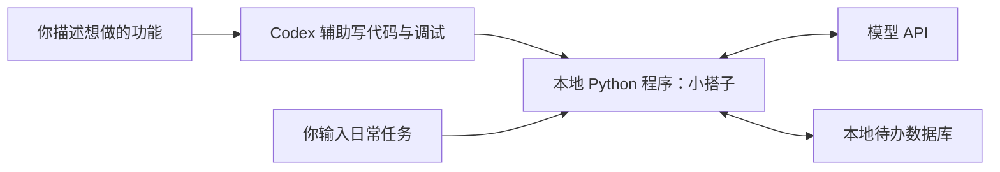
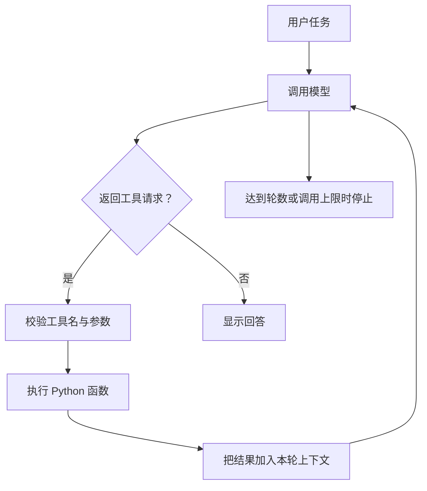

# 第一篇：用 Codex 从零做出一个能跑的个人 Agent

周五下班，你想周末去公园走走，又刷到一个感兴趣的展览。等真的有空，收藏的链接却找不到了，想去的地方也忘了一半。我们先做一个自己的周末活动搭子：说一句话，把想做的事记下来；准备出门时，再问它清单里有哪些安排。

我们的第一版“小搭子”只做添加和查询这两件事。它保存的是出行待办，不会代你预约或购票。项目小到可以读懂每个关键函数，也足够完整，能让你看到 AI 如何真正调用自己的代码。

你只需要大致理解变量、函数、列表和字典。遇到看不懂的代码，可以请 Codex 用项目里的例子解释。第一篇的目标是获得一个真实可运行的起点。

本篇路线：离线演示 → 选择一个模型 API → 添加与查询 → 读懂工具循环。第一次跟做使用配套代码即可，暂不需要飞书、服务器或搜索账号。

## 1. 先分清谁在帮谁工作

开发过程中有两个不同角色：**Codex 是编程助手，小搭子是你开发的程序。** 你向 Codex 描述需求，它帮助创建文件、改代码、运行测试；以后你启动小搭子，小搭子通过模型 API 理解任务，再执行 Python 工具。



这里的 API 是程序向模型服务发请求的接口，API Key 是调用凭据；SDK 是帮你组织这些请求的 Python 库。它们不要求你先学会训练模型。

即使关闭 Codex，只要 Python 环境、网络和 API 配置正常，小搭子仍然可以运行。开发工具的登录状态与示例程序读取的模型 API 密钥 是两件事；本教程的程序使用你配置的 API 凭据。

如果还没设置 Codex，可从[官方入门页面](https://learn.chatgpt.com/docs/quickstart)选择适合自己的入口。在 Codex 中打开项目文件夹，再发送开发请求。不同版本界面的按钮名称可能不同，我们主要通过任务描述协作。

## 2. 把需求缩小到能验收的一句话

第一版的需求是：

> 我用中文输入一句话，程序能按需添加或查询待办。重新启动后，记录还在。

先准备三个例子：

```text
帮我记下：周六去公园散步。
我现在有哪些待办？
我周末想轻松出门走走，给我一个准备建议，先不要记到待办里。
```

第三个例子很重要：我们需要区分“给建议”和“实际写数据”。验收时既看回答，也检查数据库有没有变化。

建议第一次先使用本仓库的配套代码跑通，再把下面这段交给 Codex，对照需求理解实现。想独立练习时，也可以另建空目录，请 Codex 按相同验收标准开发；自己生成的版本可能使用不同的文件名和参数。

```text
请帮我做一个适合 Python 初学者阅读的命令行 Agent，叫“小搭子”，用于记录周末想做的事。
我懂基本函数和字典，请边做边解释关键代码，不要一次引入很多框架。

第一版只提供 add_task(title) 和 list_tasks() 两个工具。
用 Python 3.10+、OpenAI Python SDK 的 Responses API、内置 sqlite3。
模型和 API Key 从环境变量读取，不写进代码。
把模型客户端创建集中到 make_client()，根据 AGENT_PROVIDER 选择服务。
根据所选服务的官方文档处理 Responses 参数差异；不要修改 Codex 配置。
由模型选择工具，由 Python 校验参数并执行，再把结果交回模型。
最多调用模型6轮、执行工具8次，达到限制时明确说任务未完成。
同名待办暂时合并；每次命令处理一个完整请求，不保存聊天历史。
提供固定脚本的 --demo 离线模式，并明确它不具备自然语言理解能力。
请直接创建代码、运行不需要 API 的检查，再解释如何接入真实模型。
```

你可以让 Codex 实现自己的版本，也可以使用本文的 [完整配套程序](examples/assistant.py)。配套程序包含后续扩展，通过 `--version 1` 只开放本篇的两个工具。

## 3. 先确认本地程序能动起来

在终端进入本教程的 `examples` 文件夹。macOS、Linux 下先检查：

```bash
python3 --version
python3 assistant.py --demo --db data/demo.db
python3 assistant.py --inspect --db data/demo.db
```

Windows 可以使用 `py --version`、`py assistant.py --demo --db data/demo.db` 和 `py assistant.py --inspect --db data/demo.db`。需要 Python 3.10 或以上版本。

离线模式会执行一个固定任务，输出形式如下。这是脚本演示，不是模型回答样本：

```text
[工具] add_task → ok=True
离线脚本演示：待办已保存。这不是模型生成的回答。
[状态] completed | 工具 1 次 | 0 tokens
```

随后 `--inspect` 应显示“周六去公园散步”。这一步验证 Python 能运行、工具能够执行、SQLite 能保存数据。它还不能证明模型会选对工具。

本节演示使用 `data/demo.db`，与后面真实模型练习分开。省略 `--db` 时，数据默认保存在 `examples/data/assistant.db`，与终端当前目录无关。想使用独立的练习数据，可以在每条相关命令后加上 `--db data/practice.db`。演示记录和真实记录也可以用不同数据库隔离。

## 4. 接上真实模型

仍在 `examples` 目录中，macOS、Linux 执行：

```bash
python3 -m venv .venv
source .venv/bin/activate
python -m pip install -r requirements.txt
```

Windows PowerShell 执行：

```powershell
py -m venv .venv
.venv\Scripts\Activate.ps1
python -m pip install -r requirements.txt
```

如果 PowerShell 阻止激活，可以直接使用 `.venv\Scripts\python.exe` 代替下文的 `python`，不必为这个项目修改系统执行策略。

接下来选择 **DeepSeek 或 OpenAI 中的一套**，只执行与你的终端对应的命令，不需要同时配置两家服务。这里配置的是小搭子的模型 API，不会更换开发时使用的 Codex。

记住三个量就够了：`AGENT_PROVIDER` 选服务商，对应的密钥变量提供凭据，`OPENAI_MODEL` 填这家服务可用的模型 ID。这个变量名沿用初版代码，并不限定只能使用 OpenAI。模型 API 账号和费用与 Codex 分开；先在所选服务的官方平台创建自己的 API Key，再回到终端配置，不要把密钥交给 Codex 或写入源码。

### 选项 A：DeepSeek

中国大陆读者可从这一套开始。配套程序通过独立适配层调用 DeepSeek 的 Responses API。下方模型 ID 沿用配套附录核对的官方示例，实际可用性以账号和[官方文档](https://api-docs.deepseek.com/guides/responses_api/)为准。

macOS 默认 zsh：

```zsh
read -s "DEEPSEEK_API_KEY?粘贴 DeepSeek API Key 后回车："
export DEEPSEEK_API_KEY
export AGENT_PROVIDER=deepseek
export OPENAI_MODEL=deepseek-flash
```

Linux Bash：

```bash
read -s -p "粘贴 DeepSeek API Key 后回车：" DEEPSEEK_API_KEY
export DEEPSEEK_API_KEY
export AGENT_PROVIDER=deepseek
export OPENAI_MODEL=deepseek-flash
```

Windows PowerShell：

```powershell
$key = Read-Host "粘贴 DeepSeek API Key" -AsSecureString
$env:DEEPSEEK_API_KEY = [System.Net.NetworkCredential]::new("", $key).Password
Remove-Variable key
$env:AGENT_PROVIDER = "deepseek"
$env:OPENAI_MODEL = "deepseek-flash"
```

完成这一套即可跳到下方“使用所选服务运行”，不必再配置 OpenAI。

### 选项 B：OpenAI

先核对[官方支持地区](https://developers.openai.com/api/docs/supported-countries)，准备自己的 OpenAI API Key。从[官方模型目录](https://developers.openai.com/api/docs/models)选择账号有权限调用、支持 Responses API 与 function calling 的模型 ID，并替换下面的占位文字；不要填写产品界面里的展示名称。

在 macOS 默认的 zsh 终端，可隐藏输入密钥：

```zsh
read -s "OPENAI_API_KEY?粘贴 API Key 后回车："
export OPENAI_API_KEY
export AGENT_PROVIDER=openai
export OPENAI_MODEL="替换为你可用的模型ID"
```

Linux Bash 使用：

```bash
read -s -p "粘贴 API Key 后回车：" OPENAI_API_KEY
export OPENAI_API_KEY
export AGENT_PROVIDER=openai
export OPENAI_MODEL="替换为你可用的模型ID"
```

PowerShell 使用：

```powershell
$key = Read-Host "粘贴 API Key" -AsSecureString
$env:OPENAI_API_KEY = [System.Net.NetworkCredential]::new("", $key).Password
Remove-Variable key
$env:AGENT_PROVIDER = "openai"
$env:OPENAI_MODEL = "替换为你可用的模型ID"
```

密钥输入时终端不回显字符是正常现象，粘贴后按回车即可。macOS 示例适用于默认 zsh；如果你使用 Bash，请选 Linux Bash 那组命令。

到这里，运行所需的最小配置已经齐全。以后切换服务时，把服务商、对应密钥和模型 ID 一起更换；更详细的配置说明与接口适配边界见[附录 A：模型 API 配置](APPENDIX-model-api.md)，首次跟做不用先读完附录。

<a id="run-model"></a>

### 使用所选服务运行

这些配置只对当前终端会话及其启动的子进程生效。示例不自动读取 `.env` 文件；如果你在另一个终端启动程序，需要重新配置。API 请求会按账户对应规则计费，先从一两条任务开始。

现在运行真正的 Agent：

```bash
python assistant.py --inspect
python assistant.py "帮我记下：周五核对公园开放信息"
python assistant.py "我现在有哪些待办？"
python assistant.py --inspect
```

DeepSeek 适配已通过本地假 HTTP 与真实 SDK 的往返测试，尚未使用真实 API Key 联调。上面四条命令也是你自己的真实模型验收；遇到 `incomplete` 应检查模型输出预算，不能当作任务成功。

先记住第一条显示的初始清单。第二条应出现 `add_task` 工具记录，第三条应出现 `list_tasks`，第四条直接查看本地数据；新标题应出现在清单中。如果该标题原本就存在，请换一个此前没有记录过的标题重试，避免把旧数据误当成刚刚成功写入。回答措辞可能变化，**是否实际保存和读取数据**才是验收重点。

## 5. 看懂最重要的那段循环

打开 `assistant.py`，先找 `run_agent()`。不必从文件第一行硬读到最后。核心过程是：把请求交给模型；如果模型提出工具调用，就执行工具；把执行结果补回上下文；继续请求模型，直到它给出回答或触及上限。



可以把 tool calling 理解成：模型提交一张“请执行这个函数”的申请单。程序负责看工具名是否允许、参数是否合法，然后真正执行。官方 Responses 文档说明了工具请求与 `function_call_output` 的往返方式。[参考：Function calling](https://developers.openai.com/api/docs/guides/function-calling)

用接近 Python 的伪代码看一遍：

```text
准备当前请求和工具描述
重复，直到达到轮数上限：
    请求模型，保留本次输出
    如果响应不完整：报告未完成，停止
    如果没有工具请求：显示回答，停止
    对每个工具请求：
        检查调用次数、工具名和参数
        执行对应函数
        把调用 ID 和执行结果一起放回上下文
```

这里比普通问答多了一次“行动—观察结果—继续判断”。一个能调用两个工具的循环，已经足够展示 Agent 的基本工作方式；不需要先加入多个 Agent 或复杂框架。

在我们的代码里，值得读懂的三个位置是 `schemas()`、`execute()`、`run_agent()`：它们分别描述能力、实际执行能力、组织整个循环。SQLite 负责保存数据，它已经随 Python 提供，不需要单独安装数据库服务。

请 Codex 带着你读代码：

```text
请沿着“帮我记下：周六去公园散步”这条输入，解释程序执行路线。
每一步指出对应函数，说明数据是什么形状。
尤其解释模型输出、真正执行工具、把结果交回模型这三者的区别。
先不要修改代码。最后给我两个理解检查问题。
```

## 6. 出错时，让 Codex 帮你缩小问题

| 现象 | 先检查什么 |
| --- | --- |
| 找不到 Python | 确认 Python 已安装；Windows 尝试 `py` |
| 找不到 `openai` 模块 | 确认当前解释器安装过 `requirements.txt` |
| 提示配置缺失 | 检查服务商、对应密钥、模型 ID 是否配套，见附录 A |
| `AuthenticationError` | 检查 Key 是否有效，不要把 Key 发进聊天 |
| `NotFoundError` / `PermissionDeniedError` | 检查模型 ID 和账号访问权限 |
| `RateLimitError` | 查看账户额度或频率限制，稍后再试 |
| 超时或网络错误 | 检查网络；先用 `--inspect` 看是否已有写入 |

给 Codex 的错误报告可以写成：

```text
我运行的是这条命令：……
Python 版本是：……
报错类型和不含密钥的错误信息是：……
离线 --demo 能/不能运行。
请定位问题并做最小修复，不要重写整个项目，也不要打印环境变量中的密钥。
```

最后再运行“给我一个周末出门准备建议，不要保存待办”。检查前后的待办数量，确认建议没有变成写入。同名待办在本项目里会合并；这只是简化设计，不等于理解了不同措辞的同一件事。

此时，你已经有一个可以关闭、重新启动、继续读取数据的个人 Agent。下一篇，我们给它自己的活动笔记和出行规划方法，让它逐渐适应你的习惯。

## 本篇完成标准

- 能区分离线固定脚本与真实模型任务，检查新标题确实写入。
- 重新启动后能查到待办；只给建议时清单没有变化。
- 能指出模型提出请求、Python 执行函数、工具结果回传这三步。

[返回系列目录](README.md) · [继续第二篇](02-grow-your-agent.md)
