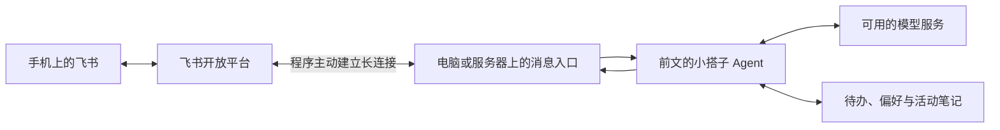
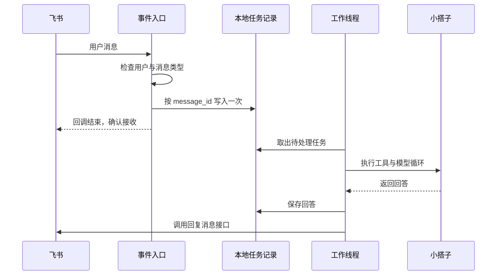

# 第四篇：把 Agent 放进口袋——用飞书聊天，再让它持续在线

走在回家的路上，你突然想到：“周六去公园走走，顺便找一家书店。”如果必须回去开电脑、切换目录、输入命令，这个念头很可能就丢了。

这一篇，我们给小搭子加一个手机入口。打开聊天软件，发一句“记下周六去公园散步”，它就能调用前几篇写好的工具，把待办存下来。之后再考虑：电脑合上盖子，它还能不能工作？

我的建议是：**先接飞书自建机器人，用长连接在本机跑通；确实需要持续在线时，再把同一程序搬到常开主机。** 对个人练习来说，这条路线能把要解决的问题分成几小步。

本文的选型和文档核对日期为 2026-10-10。延续前文，我们使用 Codex 辅助写代码；提供了 [飞书入口完整代码](examples/feishu_bot.py) 和 [Linux 服务配置](examples/deploy/xiaodazi.service)。没有替读者开通账号、购买服务器或发布机器人。

开始前：命令行真实模型已跑通，并能创建飞书自建应用。首次跟做先完成单聊回声和真实任务；消息队列原理可以在跑通后细读，Linux 部署单独放在附录。

## 1. 聊天软件和服务器，解决的是两件事

接入聊天软件，解决“从哪里发任务”。部署到服务器，解决“谁一直运行程序”。

| 组合 | 手机能不能用 | 运行电脑关机后 |
| --- | --- | --- |
| 本机命令行 | 需要自己解决远程操作，不适合这个入门项目 | 停止服务 |
| 飞书 + 本机 Agent | 可以，只要本机程序在线 | 停止服务 |
| 飞书 + 常开主机 | 可以 | 个人电脑关机不影响主机上的程序 |
| 自建网页 + 服务器 | 可以，还需要开发和维护网页入口 | 取决于服务器是否在线 |

服务器也不是必须购买的产品。家里一台持续开机、能够联网的旧电脑，就可以先承担这个角色。当然，它仍然有电费、网络和维护成本。



手机和运行程序的电脑不需要在同一个 Wi-Fi 下。长连接由程序向飞书发起，双方分别能访问所需服务即可。它解决了本地接收事件的入口问题，电脑休眠和断网仍然会让程序离线。[参考：飞书长连接说明](https://open.feishu.cn/document/server-docs/event-subscription-guide/event-subscription-configure-/request-url-configuration-case)

## 2. 为什么用飞书作为这一篇的例子

这里按“个人读者容易跟着做”的标准选择，不做所有聊天软件的综合排名。

| 候选方案 | 对本教程有利的地方 | 入门时要处理的事情 | 本文选择 |
| --- | --- | --- | --- |
| 飞书自建应用机器人 | 手机聊天入口；官方 Python SDK；长连接本地可用 | 加入或创建团队、取得应用开发权限、配置机器人权限和发布范围 | 主线示例 |
| 钉钉应用机器人 | 官方提供 Stream 模式，也能免公网回调接收消息 | 开发组织、应用权限和机器人配置 | 已经常用钉钉的读者可优先选它 |
| 企业微信机器人或应用 | 已在企业微信里工作的人不必额外切换入口 | 要按具体机器人或应用类型确认管理权限、接入方式和账号可用能力 | 已有组织与权限时再评估 |
| 自建网页聊天界面 | 页面与交互可以完全自己设计 | 页面、登录、托管和外网访问都要自己安排 | 后续想练 Web 开发时再做 |

飞书官网列有 0 元的免费版。本文以这个免费入口做个人练习，实际应用创建资格、管理员审批和 API 额度仍以账号后台为准；不把“免费版”解释成“所有能力无限使用”。[参考：飞书版本对比](https://www.feishu.cn/service?tab=free)

钉钉同样有无需公网 IP、域名和内网穿透的 Stream 方案，因此“免公网回调”并非飞书独有。我们选择飞书，是为了整套教程只维护一条清晰的 Python 接入路线；如果你每天都用钉钉，沿用已有习惯可能更省事。[参考：钉钉 Stream 概述](https://open-dingtalk.github.io/developerpedia/docs/learn/stream/overview/)

企业微信的具体能力需要按当前账号及应用类型核对。本文不将它概括成“必须收费”或“必须有公网服务器”，也不把普通微信、企业微信和群通知机器人混为一谈。由于本次未完整核实其个人账号开通链路，不选它作为需要逐步复现的主线。

另外，我们要创建的是**开发者后台里的自建应用，并开启机器人能力**。不要在群设置里拿到一个通知用 Webhook 地址，就假定已经具备完整的聊天接收能力。

## 3. 免费的边界：入口、运行机器、模型分开算

这一篇不需要先租服务器。可以用飞书免费版、现有电脑和官方 SDK，先完成一个不调用模型的连接测试。

| 项目 | 可以怎样开始 | 费用或限制来自哪里 |
| --- | --- | --- |
| 聊天入口 | 飞书免费版 | 租户权益、API 配额和限频 |
| 程序运行 | 自己的电脑 | 电费、在线时间和网络 |
| 连接测试 | 本文的 `--echo` 模式 | 不调用模型，但仍使用聊天平台 API |
| 模型推理 | 当前地区可用的模型服务 | 按服务商规则计费，赠送额度不是永久免费 |
| 持续在线 | 已有常开电脑，或后来购买云主机 | 云资源费用、续费、维护与备份 |

如果你的目标是完全不支付模型 API 费用，可以另做本地模型练习。但本地模型会带来硬件和性能要求，这一篇先不同时展开。

模型服务沿用第一篇。聊天连接和模型请求分开验收：先用 `--echo` 收到回声，再接真实模型，便于判断问题在哪一层。

## 4. 先让 Codex 加一个很薄的消息入口

小搭子原有的待办、笔记和出行技能不需要重写。新增程序负责接消息、调用 `run_agent()`、把结果回复回去。

先把这段交给 Codex：

```text
请在现有小搭子项目上新增 feishu_bot.py，使用飞书官方 lark-oapi SDK。
保留现有命令行入口和 Agent 工具，不重写核心逻辑。

本阶段只接一个指定用户发给机器人的单聊文本。
用 FEISHU_OWNER_OPEN_ID 限定用户；忽略群聊、其他用户、机器人和非文本消息。
App ID、App Secret 从环境变量读取，不写入代码。

提供 --identify：仅在本地显示单聊发送者的 open_id，不调用模型、不回复。
提供 --echo：只给允许的用户原样回复，先验证聊天链路。
正常模式再接 run_agent，周末计划以“周末计划：”前缀显式启用技能。

事件回调只做过滤、按 message_id 去重和快速落盘。
慢任务由单独工作线程串行处理，队列最多20个活动任务。
不要在事件回调里等模型回答；不要在任务中断后自动重跑可能已写入的操作。
添加离线测试，不用真实飞书账号发测试消息。
```

这里的“串行”意味着先完成一条，再处理下一条。对于自己使用的小助手，行为容易理解，也减少同一份本地数据被同时修改的问题。

配套代码默认把聊天版数据放进 `examples/data/feishu/`，与前几篇的命令行练习数据分开。这不是自动同步：你在命令行旧数据库里记的待办，不会凭空出现在新数据库中。

## 5. 在飞书后台创建自己的机器人

先在手机和电脑安装飞书，用同一账号登录。准备一个自己可以管理的测试团队，或取得所在团队管理员的应用开发许可。这里的“企业自建应用”是平台的应用类型；是否能创建、需要哪些账号信息，按当前注册流程和后台提示完成。不要直接在学校或公司的组织里申请整套通讯录权限。

进入[飞书开发者后台](https://open.feishu.cn/app)，按下面的顺序配置：

1. 创建自建应用，名称可以叫“小搭子”，开启机器人能力。
2. 在应用凭证页获取 App ID 和 App Secret。
3. 申请读取用户发给机器人的单聊消息权限 `im:message.p2p_msg:readonly`，以及以应用身份发消息权限 `im:message:send_as_bot`。
4. 按下一节先启动本地 `--identify` 程序。
5. 在“事件与回调”的事件配置中选择“使用长连接接收事件”，订阅 `im.message.receive_v1`，界面中通常显示为接收消息 v2.0。
6. 创建并发布应用版本，把可用范围限制为自己；如果需要管理员审批，完成审批后再测试。

接收消息和回复消息是两种能力，权限缺一就可能出现“收得到但回不去”。单聊接收权限与回复权限可以分别在[接收消息文档](https://open.feishu.cn/document/uAjLw4CM/ukTMukTMukTM/reference/im-v1/message/events/receive)和[回复消息文档](https://open.feishu.cn/document/server-docs/im-v1/message/reply)核对。

后台按钮名称可能变化，但要检查的对象不会变：应用机器人、凭据、单聊接收权限、应用发送权限、消息事件、可用范围、已发布版本。

长连接配置有一个容易卡住的顺序：**先让本地客户端成功连接，再到后台保存长连接订阅方式。** 官方文档说明，保存时需要有在线连接。还没有配置好模型也没关系，`--identify` 不需要模型。

## 6. 用三次小测试，把手机连起来

以下命令在 `examples` 目录执行，使用前文虚拟环境中的 `python`。本篇的 SDK 组合在 Python 3.12 上完成本地测试；若你的环境遇到 SDK 兼容问题，先让 Codex 核对 Python 版本和 `requirements-feishu.txt`。

```bash
python -m pip install -r requirements-feishu.txt
```

先设置 App ID。macOS、Linux：

```bash
export FEISHU_APP_ID="cli_你的应用ID"
```

App Secret 使用附录 A 中的隐藏输入方式。macOS 默认 zsh：

```zsh
read -s "FEISHU_APP_SECRET?粘贴 App Secret 后回车："
export FEISHU_APP_SECRET
```

Linux Bash：

```bash
read -s -p "粘贴 App Secret 后回车：" FEISHU_APP_SECRET
export FEISHU_APP_SECRET
```

Windows PowerShell 对应设置为：

```powershell
$env:FEISHU_APP_ID = "cli_你的应用ID"
$secret = Read-Host "粘贴 App Secret" -AsSecureString
$env:FEISHU_APP_SECRET = [System.Net.NetworkCredential]::new("", $secret).Password
Remove-Variable secret
```

第一步，在终端启动身份查看模式：

```bash
python feishu_bot.py --identify
```

完成上一节的事件配置与发布后，用手机在机器人的单聊窗口发“你好”。本地终端应显示该应用下发送者的 `open_id`。这个模式不会回复，是正常现象。

先按 Ctrl+C 停止身份查看模式，回到终端提示符，再设置自己的 ID 并启动回声模式：

```bash
export FEISHU_OWNER_OPEN_ID="ou_刚才显示的你的ID"
python feishu_bot.py --echo
```

PowerShell 把第一行换成 `$env:FEISHU_OWNER_OPEN_ID = "ou_你的ID"`。

第二步，再发一条新消息，例如“连接测试”。你应收到“连接测试收到：连接测试”。这证明收消息、用户识别和回复链路已经连通，还没有涉及模型。

第三步，把手机切到移动网络，再发送一次。电脑仍需在线。如果还收得到回复，说明你已经可以离开电脑使用这个入口。

每次只保留一个运行中的程序。不要同时开着 `--identify`、`--echo` 和正式模式，也不要同时在本机与服务器运行同一应用：飞书长连接不是给每个实例广播同一份事件，多个实例可能分走消息。

## 7. 接回真正的小搭子

继续使用第一篇已经跑通的模型配置。OpenAI 和 DeepSeek都经由同一个 `make_client()` 接入，飞书不要求更换服务商。若新开了终端，按[附录 A](APPENDIX-model-api.md)重新设置环境变量。

先在终端做一条最小真实请求：

```bash
python assistant.py --version 2 "我有哪些待办？" --db data/feishu/assistant.db
```

它能返回工具结果后，停止 `--echo`，再启动正式入口：

```bash
python feishu_bot.py
```

现在在手机里分别发送：

```text
帮我记下：周六去公园散步
我现在有哪些待办？
周末计划：用笔记中的虚构地点练习，周六有3小时，预算100元，偏好地铁和少走路，给主方案和雨天备选，不保存待办。
```

这版每条消息是独立任务，还没有接入聊天上下文。请发送完整请求，不要只说“把刚才那个记下来”。已有的待办和显式偏好会保留；如果想给聊天版保存偏好，可以在电脑执行：

```bash
python assistant.py --version 2 --remember "我在上海，偏好地铁和轻松步行，预算100元以内。" --db data/feishu/assistant.db
```

真实个人使用前，可以先读[第六篇的确认模式](06-boundaries-and-confirmation.md)，用 `python feishu_bot.py --confirm-writes` 启动。前面的直接写入入口便于观察最小循环，确认入口则让你先检查具体标题。学习顺序不必等同于实际使用时的配置顺序。

## 8. 为什么消息要先落盘，再慢慢处理

在命令行里，等几十秒只是终端暂时没有新输出。聊天平台还要判断：事件有没有被你的程序正常接收。

飞书要求长连接事件处理在 3 秒内完成；我们让回调只把任务快速写进 SQLite，然后由工作线程执行模型请求。平台的接收确认与最终聊天回复是两个不同阶段。



网络重试可能带来同一条消息的重复推送。这里按 `message_id` 建立唯一约束，重启后也保留去重记录；飞书接收事件文档明确推荐这个字段，不应改用 `event_id` 去重。

配套实现还做了一个有意的取舍：如果执行到一半中断，就标记为 `needs_review`，不自动重跑。如果 Agent 已经记了待办，只是回复失败，再跑一遍可能制造重复动作。

可以在运行机器上查看状态：

```bash
python feishu_bot.py --jobs
```

| 状态 | 含义 | 下一步 |
| --- | --- | --- |
| `queued` | 已落盘，还没执行 | 等待工作线程，重启后仍可取出 |
| `running` | 正在执行 | 等待结果；进程中断后转人工核对 |
| `done` | 该消息已处理，平台返回回复成功；可能只是生成提案 | 手机确认收到并检查内容 |
| `needs_review` | 执行异常或中途退出 | 先查询待办，核对可能已发生的写入 |
| `reply_pending` / `reply_failed` | 答案已保存，发送结果未确认或失败 | 核对手机端与本地记录，不直接重跑 Agent |

这里没有实现自动补发工具，也没有宣称“恰好执行一次”。回复 API 的 `uuid` 有限时去重语义，并不能单独解决所有崩溃和断网情形。当前程序保留答案供排查；后续可以让 Codex 增加只补发已存答案、不重跑任务的管理命令。

## 9. 什么时候值得搬到服务器

先用几天。只有当你确实需要在电脑休眠时使用，才值得增加部署步骤。

| 运行方式 | 适用阶段 | 主要取舍 |
| --- | --- | --- |
| 平时用的电脑 | 初次开发和试用 | 最容易调试，休眠就离线 |
| 已有常开电脑或小主机 | 个人长期使用 | 不新增云主机账单，自己维护供电和网络 |
| 普通 Linux 云主机 | 想让运行环境独立于个人电脑 | 需要付费和维护，可用进程管理器常驻 |
| 会自动休眠的免费托管环境 | 临时演示 | 不适合直接承诺长连接随时在线 |

小搭子调用的是远程模型，运行机器不需要 GPU。本文不绑定某家服务器促销价格；选机器前确认它允许常驻进程、对外连接，以及持久保存 SQLite 文件。

云函数也不是绝对不能做，但通常需要重新评估事件入口、执行时间和任务状态保存方式。对于已经跑通的长连接程序，先搬到一台常规 Linux 主机，概念更少。

需要持续在线时，再选读[番外：让小搭子持续在线——部署到 Linux（附录 B）](APPENDIX-deployment.md)。先完成下面的本机与手机验收，再决定是否部署；不部署也能继续学习第五、六篇，只需在使用聊天和定时提醒时保持本机程序运行。

## 10. 验收手机入口

先运行离线测试：

```bash
python -m unittest -v
```

新增用例检查了其他用户和群聊不能触发任务、重复消息不重复执行、队列有上限、回复失败不重跑 Agent，以及请求能被真实飞书 SDK 正确构造。它们不连接你的飞书账号，也不消耗模型额度。

真实环境还要做这些小检查：

| 检查 | 期望看到什么 |
| --- | --- |
| 手机用移动网络发消息 | 在线程序能够响应 |
| 连续发送两条任务 | 两条分别处理，不相互混淆 |
| 只请求出行建议 | 待办没有意外增加 |
| 重启程序后查询 | 待办仍在，已完成消息没有重复执行 |
| 关闭本机程序 | 本机方案停止响应，不把离线当成模型故障 |
| 服务器接管后关闭个人电脑 | 手机仍能使用服务器上的程序 |

如果收不到消息，按顺序检查：程序是否在线、是否启动了多个实例、应用是否发布、自己是否在可用范围、事件和权限是否生效、`open_id` 是否填对。能 `--echo` 却不能回答任务，再检查模型配置和额度。

离线期间发出的消息也不要假定一定会在重连后补齐。平台的事件重试不是你的无限期任务收件箱；重要事项在恢复后查询确认。

如果跟做了第二篇的可选联网扩展，安装 `requirements-web.txt` 后，可用 `python feishu_bot.py --web` 为普通聊天提供文旅官网资料搜索与读取。搜索需要在机器人进程中设置 `BOCHA_API_KEY`，仅仅读取已知文旅官网 URL 则不需要搜索密钥。使用服务器时也要更新服务启动参数和环境配置，模型凭据与搜索凭据分别管理。

本篇保留三个明确边界：只服务一个人、只处理单聊文本、每条消息独立执行。它已经能让你从手机使用自己的工具，又没有把第一个聊天入口变成一个复杂的多人系统。等你真的需要语音、连续对话或每周固定时间提醒，再分别为这些功能设计数据和评估。

**本次验证范围：** 配套离线测试与 SDK 本地检查已执行；未使用真实飞书应用、模型凭据或远程主机完成端到端联调。详细记录见 [VALIDATION.md](VALIDATION.md)。

## 本篇完成标准

- 本人单聊能收到回声，普通任务能调用原有 Agent。
- 能用手机移动网络查询，并知道合盖或停止进程会离线。
- 知道当前使用哪份数据库；接收、执行或回复失败时知道先查哪里。

满足这些条件后再继续；没有完成的真实环境检查可以先记下来，不必把模拟通过当作已经验证。

[上一篇：评估与稳定性](03-evaluate-your-agent.md) · [下一篇：定时任务与主动提醒](05-scheduled-reminders.md) · [返回系列目录](README.md)
