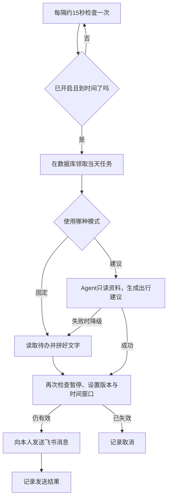

# 第五篇：定时任务与主动提醒——让小搭子记得来找你

前四篇的小搭子已经能记待办、读活动笔记，还能通过飞书在手机上使用。不过，你不找它，它就一直安静地等着。

现在换一个场景：你平时收藏了几个想去的地方，却总到周六中午才想起还没查开放时间。让小搭子在周五晚上八点提醒你看看周末清单，顺便列出出门前需要核对的事项。忙的时候，发一句命令就能暂停。

这一篇，我们用 Codex 辅助完成这个功能：**每周五固定时间，给自己发一条周末准备提醒；需要时再让 Agent 根据待办和笔记生成建议。** 默认不开启，先预览，再由你主动启用。

主线继续使用第四篇的飞书自建应用和同一个 Python 程序。配套实现见 [reminders.py](examples/reminders.py)，聊天入口见 [feishu_bot.py](examples/feishu_bot.py)。本篇不需要新买服务器，也不需要创建 Codex 应用里的自动化任务。最终运行提醒的是你自己的小搭子。

开始前：第四篇单聊入口已跑通。先做第 3 节离线预览，再做固定提醒，最后尝试 AI 建议。非周五也能用第 8 节的假时钟测试，不需要修改系统时间。

## 1. 先把需求缩小到“每周五一条”

“主动助理”很容易让人想到检查邮箱、追踪网页、监控日历、自动规划一整天。第一次实现，先把目标收敛成下面这件事。

| 项目 | 本篇约定 |
| --- | --- |
| 提醒内容 | 展示已记录的周末待办，提醒核对开放、预约、交通、天气与预算 |
| 时间 | 每周五 20:00，时刻可修改，星期固定；使用 `Asia/Shanghai` |
| 接收人 | 第四篇配置的本人 `FEISHU_OWNER_OPEN_ID` |
| 频率 | 只在本地周五触发，每个周五最多尝试一条 |
| 开关 | 默认关闭，可以从飞书开启、暂停、查询 |
| 固定模式 | Python 拼好文字，不调用模型 |
| 建议模式 | Agent 读取待办、偏好和笔记，补充一条建议 |
| 免打扰 | 23:00 至次日 08:00 不发起发送 |
| 错过时间 | 允许迟到 15 分钟；超过就跳过，不补发历史日期 |

例如，周五20:00 应该发送，程序到 20:10 才从休眠恢复：可以尝试。20:16 才恢复：记为错过，当天不再发送。刚到 20:05 才开启提醒，则等下周五，因为开启操作不会追补已经过去的时间。

这里的“最多一条”是我们程序对发送尝试的限制，不是对外部平台端到端“绝对只送达一次”的保证。后面会解释这个区别。

还有一个容易忽略的小事实：前文的待办只有添加和查询，没有“已完成”状态。因此提醒里展示的是**已记录的待办**，不能把它们全部称为“未完成事项”。本篇先复用现有数据；完成状态可以作为文末练习。

## 2. 谁看时间，谁做判断，谁发送

一个固定的闹钟，不需要模型每隔一分钟判断“现在是不是八点”。时间判断适合交给普通程序：便宜、明确，也容易测试。

小搭子的工作分成四步：检查时间、领取当天任务、准备内容、发送消息。



固定模式本身是普通自动化。建议模式才用到前几篇的 Agent：它可以决定是否查笔记、读哪篇笔记、怎样准备这次周末出行。把两部分分开，你就能先验证提醒链路，再评估建议质量。

程序每隔约 15 秒检查一次，并不追求秒级准点。机器负载、网络和模型生成都会影响实际到达时间。对于周五晚的准备提醒，这样的精度足够；如果以后做抢票或交易，这个例子就不适用了。

本篇采用一个常驻进程中的后台线程。第四篇已经让机器人持续运行，直接加上检查循环最容易理解。未来有很多不同频率的任务，再考虑专门的调度库或系统定时器。现在不要同时让 Python 循环、系统 cron 和另一个脚本都触发同一条提醒。

如果从自己的版本继续开发，给 Codex 的任务可以写成：

```text
为现有飞书小搭子增加 reminders.py，复用原进程和本人身份过滤。
先做固定文字提醒：默认关闭，上海时间每周五20:00，允许迟到15分钟。
用 SQLite 保存设置和每个周五的领取、发送状态；接收人固定为本人。
提供预览、开启、暂停、时间、模式、状态和历史入口；预览不发送也不占名额。
把时钟与发送函数作为可替换依赖，先用假时间和假发送验证重启、去重与暂停。
发送前重新核对设置；发送结果不确定时记录下来，不自动重发。
固定模式跑通后，再增加最多4轮、4次工具调用的只读建议，失败降级为固定文字。
不要替我启用提醒或发送真实消息。
```

## 3. 第一步：不联网，先看提醒长什么样

在仓库根目录打开一个终端，执行下面命令；如果终端已经在 `examples` 中，跳过第一行：

```bash
cd examples
# macOS / Linux：
source .venv/bin/activate
# Windows PowerShell 则使用：.venv\Scripts\Activate.ps1
python -m pip install -r requirements-feishu.txt
python reminders.py preview
```

预览会读取本地数据并打印类似内容：

```text
周末准备提醒 · 2026-10-12
目前没有记录待办。可以先选一个周末想去的地方或想做的活动。
出发前请核对：开放与预约信息、交通、天气和预算；这些实时信息尚未查询。
暂停提醒：/提醒 暂停
```

日期按运行当天生成。这一步**不调用模型、不发送飞书消息，也不占用当天的发送名额**。如果数据目录尚不存在，会创建目录和空的待办数据库。

聊天版默认使用 `examples/data/feishu/assistant.db`；前三篇命令行默认使用 `examples/data/assistant.db`。两者不是同一个文件。预览中看不到此前命令行的待办，先检查数据路径，不要据此判断数据库丢了。

想在聊天版数据库里放一条不依赖模型的演示待办，可以运行：

```bash
python assistant.py --demo --db data/feishu/assistant.db
python reminders.py preview
```

若第四篇已经设置了 `AGENT_DATA_DIR`，预览会读取那个目录。上面的 `--db` 也要改成该目录中的 `assistant.db`，保证两边使用同一份数据。

可以先把这段任务交给 Codex：

> 请阅读 assistant.py、feishu_bot.py 和 reminders.py，画出从待办数据库到提醒文字的数据流。先只运行离线预览，不发送消息。解释为什么命令行和飞书入口可能读到不同的待办，并指出数据目录在哪里配置。

让 Codex 帮你找到数据来源，比一开始就让它“做一个全自动生活助理”更容易得到可核对的结果。

## 4. 第二步：从手机开启，再做一次真实验收

沿用第四篇的应用配置，保持 `FEISHU_APP_ID`、`FEISHU_APP_SECRET` 和本人的 `FEISHU_OWNER_OPEN_ID` 正确。应用需要开启机器人能力、发布到包含自己的可用范围，并具备发送消息权限；按第四篇检查 `im:message:send_as_bot`。

主动提醒会新建消息，和第四篇根据原消息 ID 回复的调用不同。代码使用本地安装的飞书 SDK 构造 `CreateMessageRequest`，指定 `receive_id_type="open_id"`，收件人固定为配置中的本人。实际权限要求和平台限制请核对[飞书发送消息接口文档](https://open.feishu.cn/document/server-docs/im-v1/message/create)。本项目完成的是 SDK 本地构造检查，真实账号发送仍需按下面步骤验收，详见[验证记录](VALIDATION.md)。

先停止之前的机器人进程，再启动更新后的版本，每个应用仍只运行一个实例：

```bash
python feishu_bot.py
```

注意，`--echo` 和 `--identify` 是第四篇的连接测试模式，**不会运行提醒调度器**。正常启动时固定提醒和管理命令也不需要模型配置；只有普通自然语言任务或建议模式用到模型时，才检查模型凭据。

在与机器人的单聊里，依次发送：

```text
/提醒 状态
/提醒 时间 20:00
/提醒 模式 固定
/提醒 开启
```

机器人应回复当前开关、时间、时区与模式。命令由 Python 直接解析，不让模型猜“开启提醒”到底是什么意思。没有 `/提醒` 前缀的普通消息仍进入原有 Agent 流程，因此请使用这里列出的明确命令管理提醒。

如果测试当天是上海时间周五，可以将时间改成当前时间之后两三分钟。例如周五14:27，发送 `/提醒 时间 14:30`。时段必须在08:00–22:59内，且设置完成时尚未到点。其他星期不会发送；想立即验证逻辑，用第八节的假时钟测试，不必等到周五或更改电脑时间。

真实验收按这个顺序做：

1. 收到设置成功的回复，确认不是 `--echo` 的原样回声。
2. 保持程序和电脑在线，等待指定时刻。
3. 手机应收到一条提醒；固定模式不会调用模型。
4. 重启程序，当天不会因此再发一条。
5. 发送 `/提醒 暂停` 并确认回复，再用 `/提醒 状态` 核对。

如果当天已经尝试过一次发送，改时间也不会再发第二条。需要反复调试时间边界时，用后面的离线测试，不必删除真实记录来“骗过”去重。

### 暂停与改时间的具体含义

```text
/提醒 暂停
/提醒 时间 21:00
/提醒 模式 建议
/提醒 状态
```

修改时间或模式不会自动开启已暂停的提醒；需要时再发 `/提醒 开启`。有实际变化的设置从下一个尚未到点的周五时刻生效，不追补过去的时刻。重复发送相同设置不会重置它。

暂停可以取消尚未发出的任务。代码在内容准备好后会再查一次开关，但已经开始的网络发送无法被这条命令撤回。

提醒生成有独立线程，不占用聊天工作线程。不过，聊天命令仍按第四篇的收件队列依次处理：如果前面有较慢的普通任务，暂停命令也可能稍后才执行。以机器人的状态回复为准，不把“我点击发送了暂停”理解成服务端已经暂停。

## 5. 让 Codex 帮你理解最关键的两张表

定时功能最容易被低估的部分，是记录“今天到底做过没有”。只在内存中放一个 `sent_today = True`，程序重启就忘了。

本篇新增 `reminders.db`，里面有两张表：

| 表 | 保存什么 | 为什么需要 |
| --- | --- | --- |
| `settings` | 接收人、开关、时间、模式、设置版本、生效时间 | 重启后记得用户选择；发现生成期间的设置变化 |
| `deliveries` | 本地日期、计划时间、执行状态、内容、错误类型 | 记得当天已经领取过任务，便于排查 |

`deliveries` 的主键是 `(owner, day)`，例如 `("ou_...", "2026-10-16")`，这里的日期是上海时间周五。程序先检查星期，再领取当日任务，因此一周只会尝试一次。这里特意不把提醒时间放进主键：否则从 20:00 改成 21:00，就可能被当成当天另一个新任务。

领取操作在 SQLite 事务里完成，先查再写的过程用 `BEGIN IMMEDIATE` 串起来。网络请求不放在这个事务里，避免等模型或消息接口时一直占着数据库写锁。

你可以让 Codex 带着读代码：

> 请解释 ReminderStore.claim 和 before_send。用“周五19:00 开启、20:00 领取、生成时用户暂停”的例子，列出两张表如何变化。重点解释事务、主键和 revision 各解决什么问题；不要把它们描述成端到端恰好发送一次的保证。

`revision` 可以理解成设置的版本号。任务开始时记住版本，发送前发现用户改过时间、模式或开关，就取消旧任务。模型不需要理解这些规则，它只负责提供内容。

## 6. 重启、漏发与重复发送，先选清楚规则

考虑这样一个时刻：飞书已经接收了消息，但网络断了，程序没有收到成功响应。如果直接重试，用户可能收到两条；如果不重试，也可能漏掉一次实际未送达的提醒。

本篇选择更适合轻量周末准备提醒的取舍：**状态不确定时不自动重发，保留记录供人查看。** 这会牺牲部分送达率，换来更少的重复打扰。

| 状态 | 含义 | 本篇如何处理 |
| --- | --- | --- |
| `running` | 已领取，正在准备内容 | 完成后再次校验设置 |
| `sending` | 已记录发送意图，准备或正在调用接口 | 等待结果 |
| `sent` | 接口返回成功 | 当天不再发送；不代表用户已读 |
| `missed` | 已超过宽限窗口或进入免打扰时间 | 跳过当天 |
| `cancelled` | 生成后发现设置变化或已过期 | 取消当天这次任务 |
| `failed` | 内容准备失败，尚未进入发送 | 记录错误，当天不重跑 |
| `unknown` | 发送结果不确定，或上次运行中断 | 人工核对，不自动补发 |

程序启动时会将残留的 `running` 和 `sending` 设为 `unknown`。即使实际上还没发出去，也先不重试。这是刻意选择的保守行为，不是无损恢复。

消息还携带由“接收人 + 日期”生成的稳定 UUID，作为平台去重参数。但平台的去重能力不能替代本地记录，也不能让两个系统之间的请求变成一个原子事务。单实例和保留数据库仍然是本示例的前提。不要同时运行旧电脑和服务器上的同一个机器人，也不要把删除数据库当作日常重试方式。

在运行机器的 `examples` 目录查看最近十条记录：

```bash
python reminders.py status
python reminders.py history
```

这两条命令需要与机器人一致的 `FEISHU_OWNER_OPEN_ID` 和 `AGENT_DATA_DIR`，但不会调用飞书或模型。`history` 中保存了提醒正文，不要未经检查就把完整输出贴到公开问题里。

### 时区不要依赖服务器默认设置

服务器的系统时间可能用 UTC，而手机显示北京时间。本篇所有“今天”和“20:00”都用 `Asia/Shanghai` 计算，输入时钟必须带时区。测试里还特意用 `12:00 UTC` 验证它对应上海的 `20:00`。

Python 的 `zoneinfo` 可以使用系统时区数据；系统缺少数据时，可使用 `tzdata` 包。Windows 等环境可能需要后者，因此我们将它加入可选依赖。[参考：Python zoneinfo 文档](https://docs.python.org/3/library/zoneinfo.html)

## 7. 第三步：让 Agent 补充一条有用的建议

固定提醒稳定后，再开启建议模式：

```text
/提醒 模式 建议
```

沿用你在前文自行验收过的模型服务配置。中国大陆读者可继续使用附录 A 的 DeepSeek 适配；飞书入口不决定你必须使用哪家模型。

到点后，Agent 最多进行 4 轮模型调用、4 次工具调用，读取已记录待办、显式保存的偏好和项目 `notes/` 下的活动笔记。生成的建议附在固定提醒后面，内容围绕候选活动和出门前准备；未提供城市、时长或预算时，应指出缺少条件，不编造完整安排。

第二篇的联网工具在这里仍然关闭：即使机器人启动时给普通聊天加了 `--web`，定时建议也只用本地资料。若以后想做“每周自动搜索一个本地活动”，应另行明确搜索主题、频率、费用上限和通知条件，再显式给这个定时任务接入联网工具；本篇还没有实现这项自动搜索能力。

这里有一个很值得练习的开发习惯：**只给本次任务需要的能力。** 主动出行建议不需要添加待办，代码会从本次工具列表中移除 `add_task`，工具执行入口也会再次拒绝写入。即便模型返回了一个伪造的添加请求，数据库也不应改变。

可以给 Codex 这样的任务：

> 请检查 run_agent 的 read_only 模式是否在两层生效：提供给模型的工具列表，以及实际 execute 入口。运行一个返回 add_task 的假模型测试，证明只读任务不会写入数据库。普通聊天里的添加待办能力应继续可用。

建议模式读取的偏好也来自聊天版 `assistant.db`。如果想显式保存，可以在运行机器上执行：

```bash
python assistant.py --version 2 --db data/feishu/assistant.db --remember "我在上海，周末偏好地铁和轻松步行，通常有3小时，预算100元以内"
```

使用自定义数据目录时，同样修改 `--db` 路径。偏好和必要的资料会进入模型请求，沿用前文的资料选择方式，不需要为了这个例子导入整份私人笔记库。

模型请求失败或达到调用上限时，提醒降级为固定文字，并说明没有生成 AI 建议。如果整个准备过程已经超过发送窗口，则取消，不在深夜补发。

这一层的验收延续第三篇：建议是否确实参考已有待办？引用的笔记文件是否存在？是否符合已保存的出行偏好？是否把未核实的开放、天气或费用说成事实？没有待办时有没有虚构任务？只读运行前后数据库是否一致？本地测试能验证权限和降级，建议质量仍需要真实模型样本。

## 8. 不用等到周五，怎样测试一个定时功能

不要为测试去修改电脑系统时间。我们给 `tick()` 留了一个 `clock` 参数：生产环境传入真实时钟，测试传入指定时间；发送函数也可以换成一个只收集参数的列表。

下面这段在临时目录里跑，既不联网，也不写个人提醒记录：

```python
from datetime import datetime
from pathlib import Path
from tempfile import TemporaryDirectory
from reminders import ReminderStore, tick

with TemporaryDirectory() as folder:
    db = ReminderStore(Path(folder) / "reminders.db")
    db.configure("ou_test", datetime.fromisoformat("2026-10-16T19:00:00+08:00"),
                 enabled=True)
    now = datetime.fromisoformat("2026-10-16T20:00:00+08:00")
    sent = []
    for _ in range(2):
        tick(db, "ou_test", lambda job, time: "周六出门前核对开放信息",
             lambda *args: sent.append(args), clock=lambda: now)
    assert len(sent) == 1
```

把它保存为 `examples/try_reminder.py` 后，在 `examples` 目录执行 `python try_reminder.py`，正常结束且没有断言错误，就是“同一个周五检查两次，只尝试发送一次”的结果。

完整测试在 [test_reminders.py](examples/test_reminders.py)：

```bash
python -m unittest -v test_reminders
python -m unittest -v
```

提醒模块测试覆盖默认关闭、上海时间周五才触发、时区换算、当天去重、设置修改、生成期间暂停、超时窗口、免打扰、重启恢复、发送超时不重试、固定预览、AI失败降级、只读工具边界，以及SDK请求构造。完整测试集的当前数量集中记录在 [VALIDATION.md](VALIDATION.md)，测试未连接真实账号。

这是代码行为的验证，不是“真实提醒送达率 100%”。真实环境仍要按第四节完成手机、网络、权限和常开主机的验收。

## 9. 部署时沿用第四篇，不再启动一套调度服务

如果机器人还在个人电脑上，合盖、休眠、关机期间都不会触发检查。想每周五自动提醒，需要让运行程序的机器在对应时间在线。家里的常开电脑也可以，不必为了这一篇先购买云资源。

如果已按[部署附录](APPENDIX-deployment.md)部署到 Linux，更新代码和虚拟环境依赖后，重启原来的 `xiaodazi` 服务即可。仍沿用同一份 `AGENT_DATA_DIR`，新数据库会写入该目录。重启服务的命令是：

```bash
sudo systemctl restart xiaodazi
sudo systemctl status xiaodazi
sudo journalctl -u xiaodazi -n 50 --no-pager
```

这些命令只适用于已按部署附录配置 systemd 服务的主机。不要一边运行服务，一边再手工执行第二份 `python feishu_bot.py`。

最省事的管理入口仍是手机命令。如果需要在服务器本地核对状态，按部署附录的示例路径运行，替换自己的 `open_id`：

```bash
sudo -u xiaodazi env AGENT_DATA_DIR=/var/lib/xiaodazi FEISHU_OWNER_OPEN_ID=ou_你的ID \
  /opt/xiaodazi/examples/.venv/bin/python /opt/xiaodazi/examples/reminders.py status
```

同一入口还支持 `enable`、`pause`、`time 20:00`、`mode fixed`、`mode ai` 和 `history`。它们只修改或读取本地配置，不会自己启动一个后台服务。恢复旧备份也可能恢复出旧的发送记录，因此恢复前先停服务并核对当天状态。

当提醒没到，先看程序是否在线、数据目录和用户 ID 是否一致，再看状态记录。`missed` 要查在线时间；`unknown` 要先核对手机是否已收到；固定提醒正常而建议总降级，再查模型配置。这样排查，通常比一句“Agent 不稳定”更快找到原因。

## 10. 留三个小练习，按自己的需要继续做

- **待办完成状态。** 加入 `complete_task` 和对应评估，让提醒只展示未完成事项。先设计如何确认编号，再让 Codex 修改表结构和工具。
- **允许自选星期。** 现在只在周五触发，日期去重就能限制每周一次。如果开放周四或周六等选择，应重新设计周级去重键和生效规则，避免改星期后同周再发一条。
- **减少没必要的打扰。** 增加一个可关闭的规则，例如没有待办时跳过提醒。记录跳过原因，确保用户能分清“系统坏了”和“按规则保持安静”。

做完这一篇，小搭子就有了一个完整的主动任务入口：用户决定是否开启，程序按规则触发，Agent 按需提供建议，消息发送留下可查记录。下一次扩展能力时，可以继续沿用这几个分工。

**验证范围：** 本地代码与 SDK 构造测试已完成；真实飞书主动发送、实际模型建议和服务器持续运行尚未联调。详细依据和限制见[验证记录](VALIDATION.md)。

## 本篇完成标准

- 能离线预览，区分固定提醒与 AI 建议。
- 能开启、暂停和查询状态；知道只在上海时间周五触发。
- 能用假时钟验证去重，真实试用后能找到发送记录；未实测送达时如实标记。

满足这些条件后再继续；没有完成的真实环境检查可以先记下来，不必把模拟通过当作已经验证。

[上一篇：把 Agent 放进口袋](04-agent-on-your-phone.md) · [下一篇：操作边界与确认机制](06-boundaries-and-confirmation.md) · [返回系列目录](README.md)
